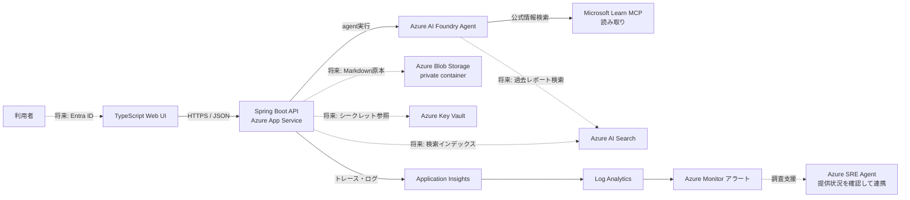

# 全体アーキテクチャ

## 実装状況

- Frontendは質問・回答・出典・レポート検索UIを実装済み。
- Backendはローカル調査モード、ファイル保存、検索に加え、Managed Identityと公式Azure Java SDKを使ったFoundry Agent + Microsoft Learn MCP調査モードを実装済み。Foundryのライブ接続は実環境のモデル・権限が必要なため未検証。
- BackendのAzure Blob Storage / Azure AI Searchアダプター、ユーザー認証・認可はまだ未実装。これらを設定だけで有効化すると起動時エラーになる。現行のBicepは将来の接続先リソースを用意するが、レポート本文はApp Service内の `/home/data/reports` に保存する開発用構成であり、水平スケールや本番データ保持を保証しない。
- BicepはFoundryの接続先とモデルデプロイ名が与えられた場合に限りFoundryモードを有効化する。接続先未設定なら明示的にローカルモードで起動する。
- Azure SRE Agent自体やエンドツーエンド運用連携は未実装。Azure Monitor / Application Insightsのテレメトリを基礎としている。

## 目的

公開情報を調査し、根拠となる出典を添えた回答と再利用可能なレポートを作成する。公式情報と過去のレポートを区別し、回答の正確性・更新時点・出典を利用者が確認できるようにする。

## 構成図



Foundry agentがどのツールを直接呼び出すか、APIが検索・保存を担うかは実装アダプターに依存します。どの方式でも、回答とともに出典URLを返し、Blobを正本、Searchを再生成可能なインデックスにする契約を維持します。

## 責務とデータ境界

| コンポーネント | 責務 | 永続化するもの |
| --- | --- | --- |
| Frontend | 質問入力、回答・出典表示、レポート閲覧と検索 | 原則なし。認証トークンや回答本文を独自に長期保存しない |
| Backend | 認証・入力検証、agent呼び出し、レポート出力、Blob/Search連携 | アプリケーション状態。シークレットは保存しない |
| Foundry agent | 質問の調査と回答生成、許可されたツールの利用 | agent定義・実行履歴はFoundry側の仕様と保持ポリシーに従う |
| Microsoft Learn MCP | Microsoft公式Learnコンテンツの検索・参照 | 外部ソース。利用時点のURL・取得日時をレポートに記録 |
| Blob Storage | レポートの正本を保存 | Markdown、生成HTML（必要な場合）、メタデータ |
| Azure AI Search | 保存レポートをアプリとagentから検索 | Blob由来のチャンク・検索フィールド。正本ではない |
| Azure Monitor | 可用性・ログ・トレース・アラート | 運用テレメトリ。回答本文や認証情報は極力含めない |

ユーザーが作成するレポートと、開発者向けの設計ナレッジは保存先を分けます。前者はBlob/Search、後者はこのplatformリポジトリに置きます。

## 出典の扱いと検索ナレッジ

- Microsoft Learnなどの公式ドキュメントを一次情報として優先する。公式ブログ、リリースノート、外部記事を使う場合は、回答内で出典の種別が分かるようにする。
- 出典にはタイトル、絶対URL、取得または確認日時を持たせる。URLを追跡できない情報は検証済みの事実として扱わない。
- 保存済みレポートは調査の手掛かりであり、公式ソースそのものではない。新しい質問では必要な主張を一次情報に照らして再確認し、矛盾や古さがあれば明記する。
- AI Searchには少なくともレポートID、タイトル、Markdown本文またはチャンク、作成日時、出典URL、言語、アクセス境界を登録する。インデックスからBlob上の正本へ戻れるIDを必須にする。
- 検索対象のアクセス境界（全社共有、チーム、個人）を決め、認可フィルターなしに異なる範囲のレポートを混在させない。
- レポートには生成日時と参照した出典の確認時点を含める。製品仕様やリリース時系列など変わりやすい情報は、検索順位より出典の更新日時を重視して再確認する。

## 質問からナレッジ登録まで

1. UIから質問をAPIへ送る。APIは空入力・サイズ・レート制限を検証し、ユーザーの認証コンテキストを適用する。
2. agentは許可された公式ソース（Microsoft Learn MCP等）を検索する。保存済みレポートは「既存知識」として検索するが、公式ソースと同じ信頼度で扱わない。
3. agentは要約、回答、出典名・URLを生成する。十分な出典が得られない場合は不確実性を明記する。
4. APIはMarkdownを生成し、Blobへ一意なレポートIDで保存する。保存が成功した後に検索インデックスへ反映する。
5. UIは回答・出典と保存レポートを表示する。レポート検索は同じ検索インデックス／APIを使う。

Blob保存に成功しSearch登録だけ失敗した場合、レポートを失敗扱いで捨てず、インデックス登録状態を追跡して再試行できる設計にする。現状のローカル実装では単一ローカルストアのため、この分散状態管理は未実装。Cloudアダプター追加時に運用制約として扱う。

## API契約（初期版）

ローカル開発ではbackendリポジトリのREADMEと実装を正本とする。おおよその形は次のとおり。

```http
POST /api/questions
Content-Type: application/json

{"question":"GitHub Copilotのガードレールについてまとめて"}
```

```json
{
  "answer": "出典に基づく回答...",
  "sources": [{"title": "公式ドキュメント", "url": "https://learn.microsoft.com/..."}],
  "report": {
    "id": "report-id",
    "title": "GitHub Copilotのガードレール",
    "markdown": "# ...",
    "html": "<h1>...</h1>",
    "createdAt": "2026-01-01T00:00:00Z"
  }
}
```

- `GET /api/health`: アプリの稼働確認。依存先のreadinessは必要に応じて分離する。
- `GET /api/reports?q=...`: レポート一覧・検索。結果はページング可能にする。
- `GET /api/reports/{id}`: 保存されたレポートを取得する。

回答とレポートには出典のURLと確認日時を含める。HTMLを保存または返す場合でも、生のモデル出力をそのまま実行可能HTMLとして信頼しない。

## ローカル開発

3つのリポジトリを並べて起動し、Frontendは `http://localhost:5173`、Backendは `http://localhost:8080` を使う想定です。各リポジトリのREADME記載が更新された場合は実際の設定値を優先し、ここも合わせて変更します。

初期段階ではローカル保存とローカル調査プロバイダーを利用できます。これは配線・画面の開発用であり、実際の調査結果ではありません。FoundryモードとMicrosoft Learn MCPアダプターは実装済みですが、Azureのライブ接続は未検証です。Blob/Searchを含むクラウド統合を有効にする際は、既知のテスト質問で公式出典・権限・保存・検索を一連で検証します。
